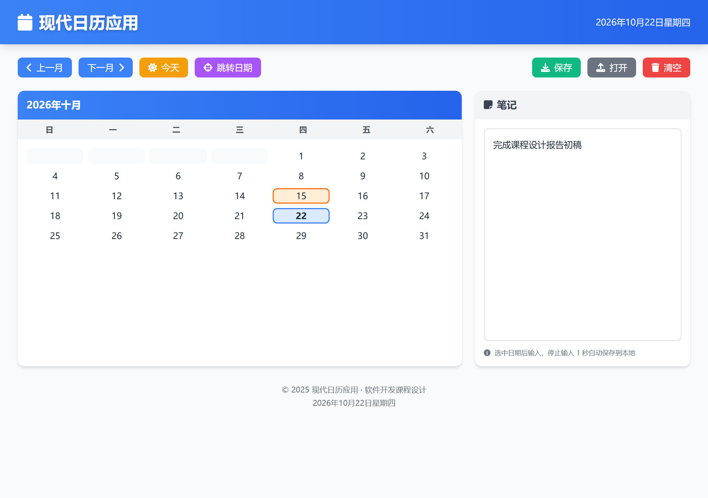
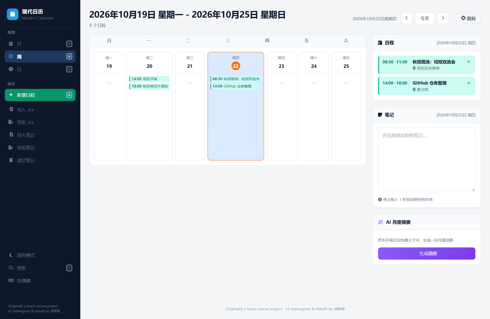
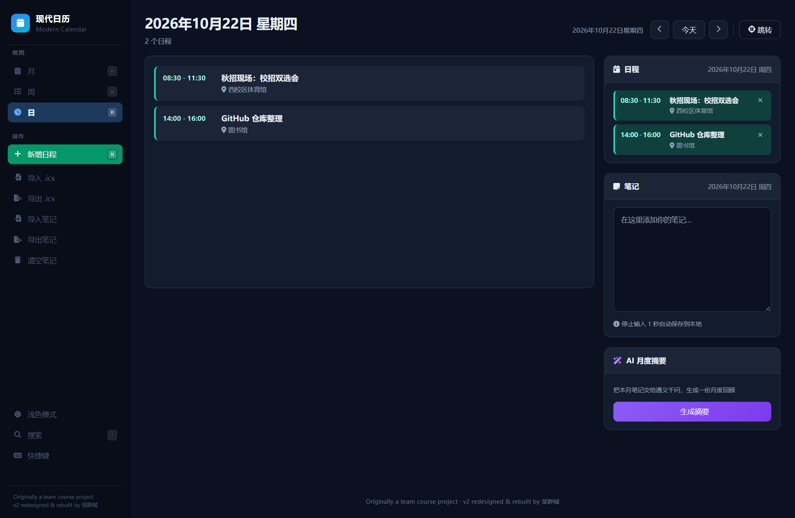

# 现代日历应用 · Modern Calendar

> 齐齐哈尔大学 · 软件开发课程设计（2025.09.25 – 2025.11.25）
> 团队：张桓浩 / 邹晔铖 / 吴奇
> 技术栈：原生 JavaScript（ES6 Class）+ Tailwind CSS v3 + Font Awesome + localStorage

一个零依赖、零构建的现代日历应用。打开 `index.html` 就能用，不需要服务器、不需要打包。

[](https://github.com/Qyy185/ModernCalendar/actions/workflows/ci.yml)
[](https://github.com/Qyy185/ModernCalendar)
[](https://github.com/Qyy185/ModernCalendar)
[](LICENSE)
[](package.json)



<table>
<tr>
<td width="50%"></td>
<td width="50%"></td>
</tr>
<tr>
<td align="center"><b>周视图</b>——七列并排，每格列出当天日程</td>
<td align="center"><b>日视图 · 深色模式</b>——时间轴排列</td>
</tr>
<tr>
<td colspan="2" align="center"></td>
</tr>
<tr>
<td colspan="2" align="center"><b>全文搜索</b>——<code>/</code> 唤起，跨笔记与日程检索</td>
</tr>
</table>

> **项目说明**：本项目最初是三人合作的软件开发课程设计（2025 秋）。
> **v2 由 邹晔铖 主导重构** —— 界面重做、架构拆分、补齐单元测试与 CI、
> 新增三视图 / 日程 / 深色模式 / 搜索 / AI 摘要 / RFC 5545 日历互导。
> 原课程设计文档见 git 历史 v1 版本。

---

## 功能

| 模块 | 说明 |
|---|---|
| **三视图日历** | 月 / 周 / 日自由切换，共享同一个选中日期；月视图格子里**直接显示日程条** |
| **日期跳转** | 输入年/月/日跳到任意日期，非法日期（如 2 月 30 日）被拦截并提示 |
| **按日笔记** | 停止输入 1 秒自动保存；可导出 `.txt`、可导入回填 |
| **日程事件** | 一天可挂多条（时间区间 + 标题 + 地点），周/日视图按时间轴排列 |
| **.ics 导入导出** | 完整实现 RFC 5545，导出后可直接进手机 / 系统日历 |
| **AI 月度摘要** | 把当月笔记交给通义千问生成回顾，无 Key 时优雅降级 |
| **深色模式** | CSS 变量驱动，偏好记入 localStorage |
| **全文搜索** | `/` 唤起，跨笔记与日程检索，命中可一键跳转 |
| **键盘快捷键** | `T` 今天 · `M/W/D` 切视图 · `←→` 翻页 · `N` 新增 · `/` 搜索 |
| **响应式** | 桌面为侧边栏工作台，手机自动收成抽屉；320px 起可用 |

---

## 运行

```bash
# 方式一：直接双击 index.html
#   ⚠️ file:// 协议下所有功能都正常（本项目不依赖任何网络请求）

# 方式二：起个本地服务（推荐，避免个别浏览器的 file:// 限制）
python -m http.server 8080
# 然后访问 http://localhost:8080/
```

> Tailwind 与 Font Awesome 走 CDN，若要完全离线，可把两个库下载到本地并改 `index.html` 的引用路径。

### AI 月度摘要（可选）

需要配置模型 Key。在 `index.html` 的 `</body>` 前加一行：

```html
<script>window.CALENDAR_CONFIG = { dashscopeApiKey: 'sk-你的Key' };</script>
```

不配置也能用，点了会提示如何配置。Key 从[百炼控制台](https://bailian.console.aliyun.com/)获取。

### 测试

```bash
npm install      # 只装开发依赖（vitest），运行时不依赖任何包
npm test         # 跑单元测试
npm run coverage # 跑测试并生成覆盖率报告（coverage/ 目录）
```

CI 配置在 `.github/workflows/ci.yml`，每次 push 自动跑测试 + 语法检查。

---

## 架构

十个模块，职责单一，通过实例关联协作，改一处不影响另一处：

```
┌────────────────────────────────────────────────────────┐
│  app.js                                                 │
│  ├─ Calendar          日期计算（纯逻辑，无 DOM）        │
│  ├─ CalendarRenderer  渲染 + 交互 + 笔记持久化         │
│  ├─ FileHandler       导入导出（静态方法）              │
│  ├─ DateJump          跳转控制 + 日期合法性校验         │
│  ├─ ViewManager       月 / 周 / 日三视图                │
│  ├─ ThemeManager      深浅色主题切换                    │
│  ├─ EventStore        日程事件的数据层                  │
│  ├─ AiSummary         AI 月度摘要（可降级）              │
│  ├─ SearchController  全文搜索（笔记 + 日程）           │
│  └─ ShortcutManager   键盘快捷键                       │
│                                                          │
│  ics.js  RFC 5545 日历文件解析与生成（纯函数）          │
└────────────────────────────────────────────────────────┘
```

| 文件 | 职责 |
|---|---|
| `js/calendar.js` | 日期计算：天数、首日星期、月份切换、网格数据生成；`formatLocalDate` / `pad2` 工具 |
| `js/ics.js` | RFC 5545 解析与生成：转义、折行、日期时间解析、往返一致性 |
| `js/event-store.js` | 日程事件 CRUD、`.ics` 导入导出、按月统计 |
| `js/renderer.js` | 日历网格渲染（含格内日程条）、选中高亮、笔记读写、自动保存定时器 |
| `js/file-handler.js` | Blob 导出、FileReader 导入（txt / ics） |
| `js/date-jump.js` | 模态框交互、日期合法性校验、跳转执行 |
| `js/views.js` | 三视图渲染与切换、焦点日期管理 |
| `js/theme.js` | 深浅色主题，CSS 变量 + localStorage 记忆 |
| `js/ai-summary.js` | AI 月度摘要：上下文组装、Prompt 构造、接口调用与降级 |
| `js/search.js` | 全文搜索：扫 localStorage，命中渲染与跳转 |
| `js/shortcuts.js` | 键盘快捷键：输入框不拦截、弹窗只响应 Esc |
| `js/app.js` | 初始化、事件绑定、页面卸载前兜底保存 |
| `css/style.css` | CSS 变量主题、侧边栏布局、日期格子状态、三视图样式、响应式 |

**分层原则**：纯逻辑（日期计算、ics 解析、上下文组装）不碰 DOM，可以直接跑单元测试；
只有渲染与交互层依赖浏览器。

---

## 测试

`tests/unit.test.js` 一个文件，69 个用例，覆盖核心逻辑：

| 测试组 | 覆盖内容 |
|---|---|
| **Calendar · 日期计算** | 闰年（含 2000/1900 边界）、大小月、首日星期、跨年进位、网格数据完整性、时区安全 |
| **ics · 转义与折行** | 转义往返一致性、折行不劈开多字节字符、每行 ≤75 字节、续行以空格开头 |
| **ics · 解析** | floating time / UTC / 全天三种日期形式、真实日历应用 .ics 样本、LF 兼容、反折行、VALARM 嵌套忽略 |
| **ics · 生成** | CRLF 行尾、结构完整、生成→解析往返一致、**与外部日历应用双向互导** |
| **EventStore** | 事件 CRUD、月份统计、`.ics` 导入去重（全日事件）、导出往返 |
| **AI 摘要** | 上下文组装（只收有笔记的日期、不跨月）、Prompt 构造、401/429/500/空响应各类降级、请求体格式 |
| **搜索** | 笔记与日程都能搜到、标题/地点/描述都参与匹配、大小写不敏感、结果按日期倒序 |
| **快捷键** | 输入框识别（不在打字时误触发快捷键） |

**覆盖率**（`npm run coverage`）：

| 文件 | 覆盖率 |
|---|---|
| `js/calendar.js` | **100%** |
| `js/ics.js` | **95.75%** |
| `js/event-store.js` | **92.59%** |
| **整体（可测部分）** | **80.89%** |

> 依赖 DOM 的模块（渲染层、视图切换、搜索渲染、快捷键事件绑定）不计入统计，
> 它们的纯逻辑部分单独测了，其余在浏览器端用 CDP 实测。

CI 每次 push 自动跑，覆盖率报告作为 artifact 保留 7 天。

#### 测试是怎么加载浏览器脚本的

`js/` 下的文件是给浏览器用 `<script src>` 加载的普通脚本，里面不能用 `export`，
也就没法直接 `import` 进测试。`tests/loader.js` 用 `vm.runInThisContext` 逐个执行，
每个文件带自己的 filename —— 这样既保留了「双击 index.html 就能用、零构建」，
又能让 v8 覆盖率把执行到的代码准确归因回源文件。

> 踩过的坑：把多个文件拼进一个 `new Function` 求值，只有最后一个文件能被归因，
> 其他文件覆盖率全是 0%。逐个 `vm.Script` 执行才能解决。


无后端，全部落在浏览器 `localStorage`（约 5MB 容量）：

| Key | 类型 | 说明 |
|---|---|---|
| `calendar_selected_date` | string | 上次选中的日期，`YYYY-MM-DD`（本地时区） |
| `calendar_note_YYYY-MM-DD` | string | 指定日期的笔记内容，日期在 key 中 |

---

## 踩过的坑

这个项目最有价值的部分不是代码，是这几个问题的解法。

### 1. 日期计算：月份 0-based 与闰年

**现象**：2024 年 2 月显示 28 天，11 月显示 31 天，2025 年 1 月 1 日（周三）显示成周二。

**原因**：`new Date(year, month, 0)` 取的是**上个月最后一天**，不是当月；且 `Date` 的月份参数从 0 开始。

**解法**：
```js
getDaysInMonth(year, month) {
  return new Date(year, month + 1, 0).getDate();  // 下个月第 0 天 = 当月最后一天
}
getFirstDayOfMonth(year, month) {
  return new Date(year, month, 1).getDay();
}
```
两个方法都要求传入 **0-based** 的月份参数，全项目统一，避免混用。

### 2. 时区：用 `toISOString()` 存日期会差一天

**现象**：本地 15 号写的笔记，键名却变成了 `2026-10-14`。

**原因**：`toISOString()` 返回的是 **UTC** 时间。东八区本地时间 00:00–08:00 之前，UTC 还是前一天。

**解法**：统一用本地时区格式化。
```js
function formatLocalDate(date) {
  const y = date.getFullYear();
  const m = String(date.getMonth() + 1).padStart(2, '0');
  const d = String(date.getDate()).padStart(2, '0');
  return `${y}-${m}-${d}`;
}
```
选中日期也存本地日期串而非 ISO 时间戳，否则读回来再取 `getDate()` 同样会偏。

### 3. 自动保存冲突：快速切日期会丢笔记

**现象**：输入笔记后立刻点另一个日期，前一天的笔记没保存就被覆盖。

**原因**：自动保存用了 1 秒 `setTimeout` 延时，切日期时上一个定时器还没触发。

**解法**（三重保险）：
1. 切换日期前**主动**调 `saveCurrentNote()`，不等定时器
2. 输入时先 `clearTimeout` 再重设，避免多次触发
3. `beforeunload` 时强制保存一次，防止关页面前最后 1 秒的输入丢失

### 4. Tailwind 类名冲突：选中态不显示

**现象**：给日期格子加上 `bg-orange-100` 后，橙色背景不生效，仍然是白色。

**原因**：Tailwind 的 `bg-white` 和 `bg-orange-100` 特异性相同，**谁生效取决于样式表里的顺序**，与类名书写顺序无关。而 Tailwind CDN 版是运行时注入 `<style>`，位置在自定义 CSS 之后。

**解法**：日期格子的状态样式**一律用自定义类**（`is-today` / `is-selected` / `is-jumped`），
不用 Tailwind 工具类管背景和边框。

### 5. 响应式：320px 下工具栏挤成一团

**现象**：小屏按钮重叠、格子文字溢出、笔记区高度不够。

**解法**：工具栏加 `flex-wrap`；日期格子加 `min-w-[40px]`；笔记区高度改 `h-[300px] md:h-[400px] lg:h-96`。

---

## 兼容性

- 浏览器：Chrome / Firefox / Edge / Safari 功能与样式一致
- 设备：1920px、1366px、768px、375px、320px 均适配
- 性能：日历切换响应 < 200ms；自动保存无感知；10KB 文件导入导出 < 500ms

---

## 已知不足

- 仅单条纯文本笔记，无富文本、事件提醒、重复事件
- 仅月视图，无周/日视图
- `localStorage` 不跨设备同步，清除浏览器数据即丢失
- 文件导入无大小限制，超大文件可能卡顿

---

## 后续可做

- 接入 IndexedDB + 云同步，解决跨设备问题
- 加周/日视图切换
- 笔记富文本化（加粗、图片）
- 暗色模式

---

## 许可

MIT License · 仅用于学习交流
